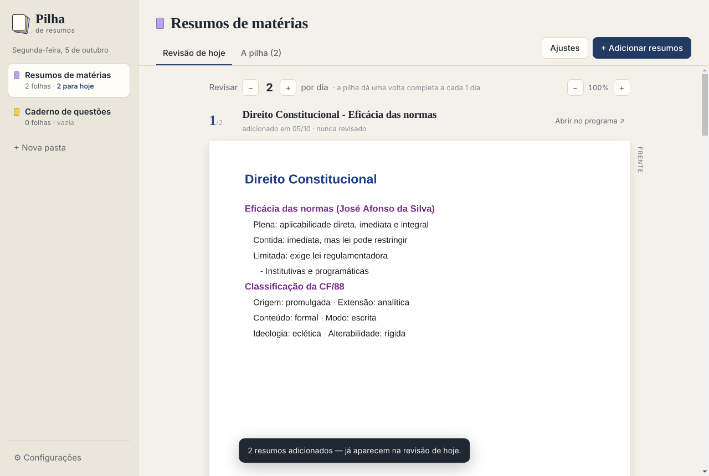
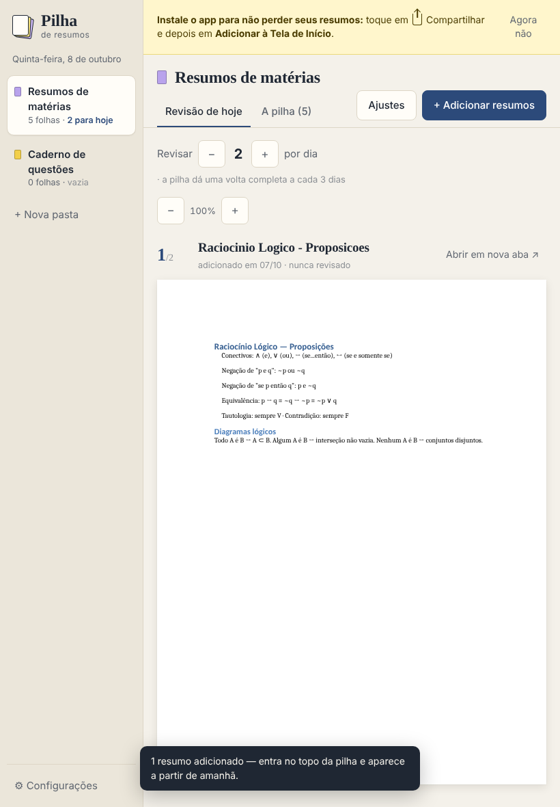
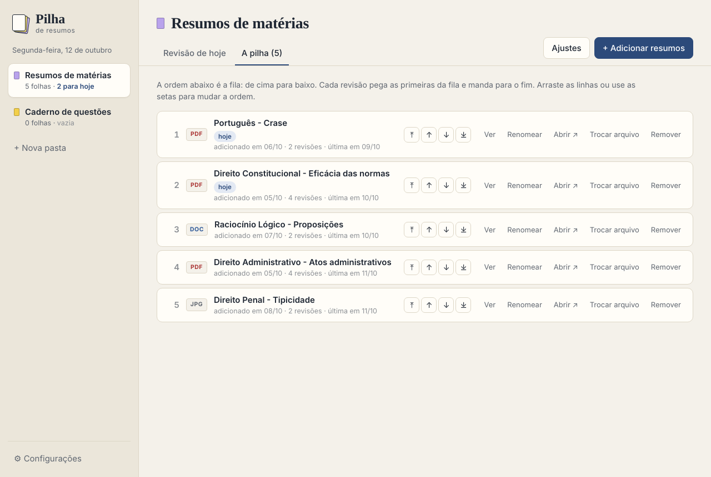
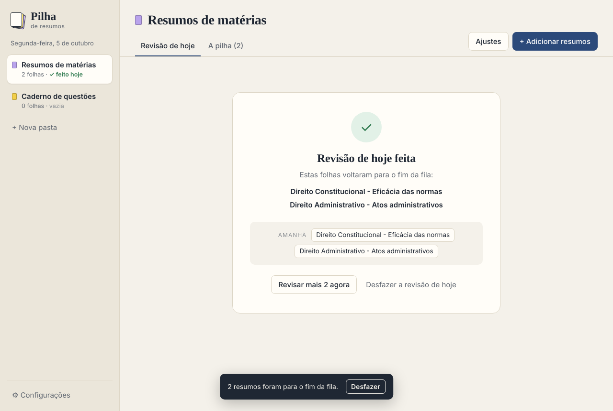
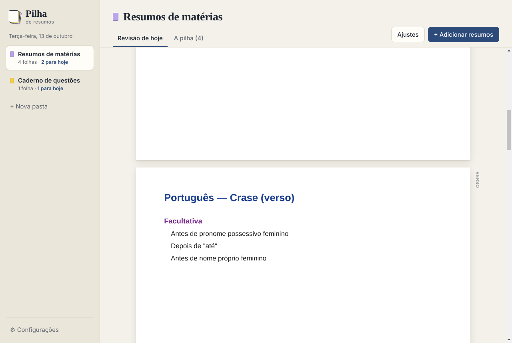

# Pilha de Resumos

App para revisar **resumos comprimidos** (uma folha A4, frente e verso) no método de pilha: todo dia você revisa as próximas folhas da fila, elas vão para o fim, e quando a fila acaba ela recomeça. Assim cada resumo é revisado várias vezes ao longo do estudo, sem precisar passar nada a limpo no papel.



## Usar

### No computador (Windows)

Vá em **[Releases](../../releases/latest)**, baixe `Pilha-de-Resumos-Windows.zip`, extraia a pasta e abra **Pilha de Resumos.exe**. Não precisa instalar nada.

Na primeira vez o Windows pode mostrar *"O Windows protegeu o computador"*: clique em **Mais informações → Executar assim mesmo** (o app não tem assinatura paga da Microsoft).

### No iPad (ou qualquer navegador)

1. Abra **https://rafaelguido.github.io/Pilha-de-Resumos/** no Safari.
2. Toque em **Compartilhar → Adicionar à Tela de Início**. O app ganha ícone próprio, abre em tela cheia e funciona sem internet.
3. Adicione os resumos pelo botão **+ Adicionar resumos** (app Arquivos, iCloud Drive, Fotos…).

Os resumos ficam guardados **só no aparelho**, dentro do navegador: não há conta, login nem servidor, e nada é enviado para a internet. Por isso:

- **Instale na Tela de Início.** Aberto só como site, o Safari pode apagar os dados de sites que ficam vários dias sem uso.
- **Faça backup de vez em quando** em *Configurações → Exportar backup* e salve o .zip no iCloud Drive. O mesmo backup restaura a pilha em outro iPad ou no app de Windows, e vice-versa.



## Como funciona

- **Pastas separadas**, cada uma com a sua pilha. Vem com *Resumos de matérias* e *Caderno de questões* (os erros dos simulados); dá para criar outras.
- **Adicione os resumos** em PDF, Word (.docx) ou foto da folha (JPG/PNG), pelo botão ou arrastando os arquivos para a janela.
- **Todo dia** o app mostra as próximas folhas da fila (2 por padrão). Perto da prova, aumente para 3, 4, 5 com o `− / +`.
- Terminou? **Concluí a revisão de hoje**: essas folhas vão para o fim da fila e amanhã vêm as seguintes.
- **Resumo novo** entra no topo da pilha e aparece a partir do dia seguinte (dá para mudar para "fim da fila" nos ajustes da pasta).
- Pulou um dia? O app continua de onde parou, sem acumular.
- Na aba **A pilha** você vê a ordem da fila, reordena (arrastando ou pelas setas), renomeia, troca o arquivo por uma versão nova ou remove.

| A fila | Depois de revisar | Frente e verso |
|---|---|---|
|  |  |  |

### Onde ficam os arquivos

**Windows:** o app guarda uma cópia de cada resumo em `Documentos\Pilha de Resumos`, junto com `pilha.json` (a ordem da fila e o histórico de revisões). Em **Configurações** dá para mudar para uma pasta do Google Drive ou OneDrive e ter backup. Arquivos removidos vão para a subpasta `_removidos`.

**iPad / navegador:** no armazenamento do próprio navegador (IndexedDB), só naquele aparelho.

**Backup:** *Configurações → Exportar backup* gera um .zip com todas as pastas, folhas e a ordem da fila. Ele funciona nas duas versões, então também serve para levar a pilha do computador para o iPad.

## Desenvolvimento

A interface (`app/`) é a mesma nas duas versões. No Windows ela roda dentro do [Electron](https://www.electronjs.org/), que guarda os arquivos no disco (`main.js` + `preload.js`); no navegador, `app/web-api.js` oferece a mesma API guardando tudo no IndexedDB, e `app/sw.js` deixa o app funcionar offline. PDFs são desenhados com [pdf.js](https://mozilla.github.io/pdf.js/) e arquivos do Word com [docx-preview](https://github.com/VolodymyrBaydalka/docxjs); as duas bibliotecas já estão copiadas em `app/vendor`, então o app não tem dependências em tempo de execução.

```bash
npm install
npm start                            # abre o app
PILHA_HOJE=2026-10-20 npm start      # finge que hoje é outra data (para testar a fila)
PILHA_DADOS=/tmp/teste npm start     # usa outra pasta de dados
npm run build:win                    # gera dist/Pilha de Resumos-win32-x64
python3 -m http.server -d app 8080   # versão web em http://localhost:8080 (?hoje=2026-10-20 também funciona)
```

No Windows, `gerar-windows.bat` faz o `npm install` + build com dois cliques.

### Publicar uma versão

O workflow `.github/workflows/release.yml` gera o zip do Windows no GitHub Actions a cada push na `main` que mexa no app, e publica em **Releases** com a versão do `package.json`:

- mesma versão → o zip da release atual é substituído;
- versão nova (ex.: mude `"version"` para `1.1.0`) → cria a release `v1.1.0`.

Também dá para rodar manualmente em *Actions → Gerar app Windows → Run workflow*.

A versão web é publicada pelo workflow `.github/workflows/pages.yml` no GitHub Pages, também a cada push na `main` que mexa em `app/`. (Pré-requisito, uma vez só: *Settings → Pages → Source: GitHub Actions*.)

### Estrutura

```
main.js        Windows: janela, leitura/cópia de arquivos, pilha.json
preload.js     Windows: ponte segura entre a janela e o main
app/           interface (HTML/CSS/JS), igual nas duas versões; bibliotecas em app/vendor
app/web-api.js navegador: mesma API do preload, guardando no IndexedDB
app/sw.js      navegador: modo offline (service worker)
build/         ícone do .exe
```

A regra da fila fica em `app/app.js` (`elegiveis`, `selecaoDoDia`, `concluirHoje`): a revisão do dia pega as primeiras N folhas da fila, ignorando as adicionadas hoje; ao concluir, elas vão para o fim.

## Licença

[MIT](LICENSE): pode usar, modificar e distribuir à vontade, mantendo o aviso de copyright.
